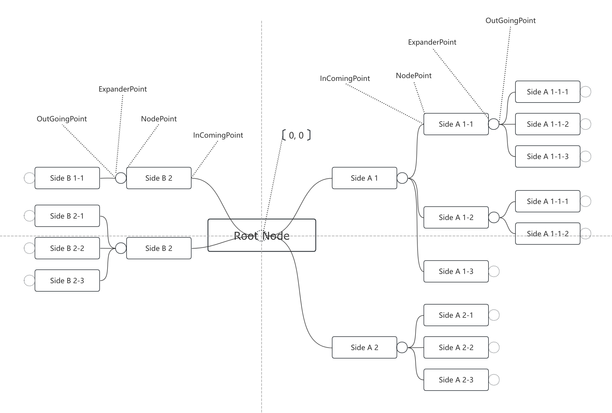
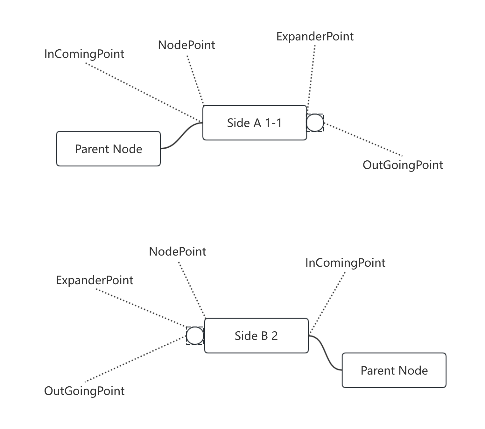
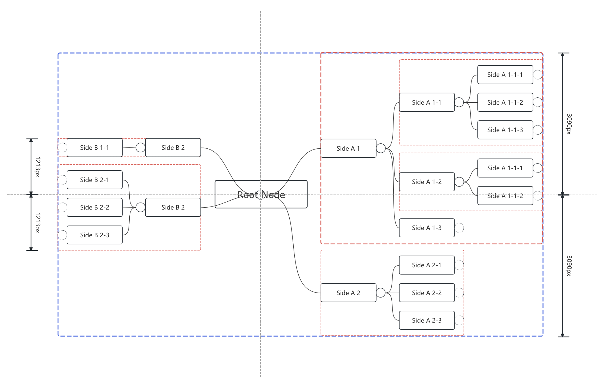
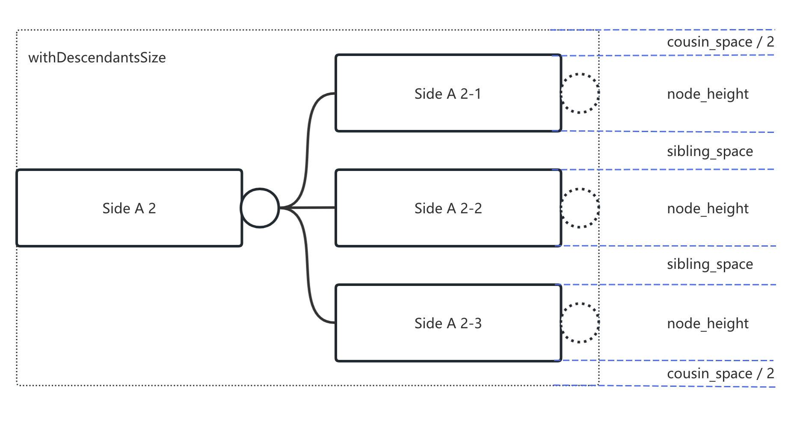
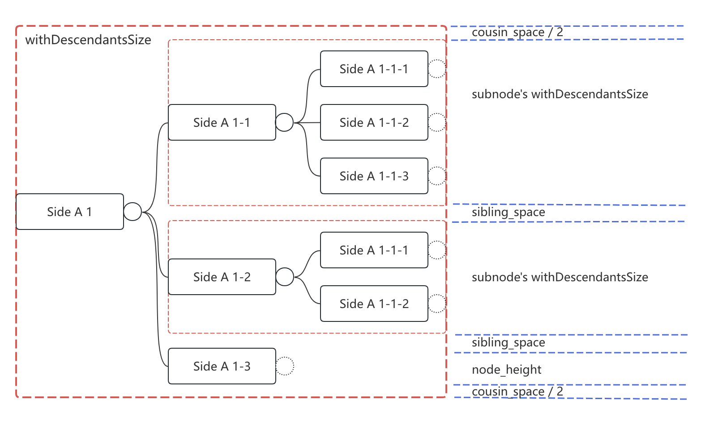

# Layout system

The jsMind v2 layout algorithm lives in `src/arranger/mindmap.ts` (`MindmapArranger`). It is **pure computation** and accepts no DOM dependency — node sizes are fed in from the outside (`recordNodeSize`), and geometry is computed internally. That is why the layout tests can run in Node (644 lines of tests) without a browser.

## 1. Coordinate system

The layout defines three kinds of points. Mixing them up will make connections drift:

| Method | Meaning | Example (Child A, size 60×28, side=1) |
|---|---|---|
| `calculateNodeIncomingPoint` | **Anchor**: parent anchor plus accumulated `offsetToParent`. The root is always `(0,0)`, the origin of the coordinate system | `(70, -24)` |
| `calculateNodePoint` | **Top-left of the node**: the anchor, then adjusted by `side` and the node's own size | `(70, -38)` |
| `calculateNodeOutgoingPoint` | **Outgoing point**: anchor + `(size.width + expanderSize) × side` | `(143, -24)` |



**`outgoing.x` does not sit on the node's right edge; it is one `expanderSize` (the expander button width, 13px) beyond it.** When writing assertions, do not compare `outgoing` with the node edge — they will differ by those 13px.



## 2. Box model

Each node is made of three layers of size:



| Layer | Contents |
|---|---|
| **Content area** | Text + padding |
| **Node box** | Content area + border |
| **Expander** | Fold button, on the right of the node (or on the left for left-side nodes), 13px |



The expander does not participate in the node's width calculation — node width is determined by content, and the expander is appended on the side.



## 3. Layout pipeline

```
① Measure: create the node DOM → read offsetWidth/Height → arranger.recordNodeSize()
② Layout: arranger.calculate(mind) → each node gets point / incoming / outgoing
③ Render: view.settle(mind) → place node DOM + draw SVG connections
```

The three steps communicate through data. The renderer does not reach back into the arranger, and it does not measure on its own. Size is input; coordinates are output.

## 4. Spacing rules

The layout has these spacing parameters (in `LayoutOptions`):

| Parameter | Default | Meaning |
|---|---|---|
| `parentChildSpace` | 30 | Horizontal distance from the parent's edge to the child's edge |
| `siblingSpace` | 20 | Vertical gap between sibling nodes |
| `cousinSpace` | 15 | Vertical gap between cousin nodes (different parents) |
| `expanderSize` | 13 | Width of the fold button |

**Note: the gap between sibling nodes is not always exactly `siblingSpace = 20`.** The vertical space a node occupies is the height of its entire subtree block. The gap between leaf siblings is siblingSpace (20px), but siblings that have subtrees are much farther apart — that is not a bug; it is determined by subtree height.

## 5. Direction

`JmNodeSide` decides which side a node is laid out on:

| Value | Meaning |
|---|---|
| `-1` (SideB) | Left |
| `0` (Center) | Centered — only the root is allowed to use this |
| `1` (SideA) | Right |

Child nodes inherit the parent's direction by default. `side: 0` is not “in the middle”; it means “no direction” — the layout needs it to know the point from which both sides spread out. If a child carries `0`, the layout cannot find a landing point and the node is not drawn. The validator (`E_NON_ROOT_SIDE_CENTER`) intercepts this case.

## 6. Canvas area limit

PNG export has to go through canvas encoding, and canvas has an area limit. Measured on Chromium:

| Output size | Area | Result |
|---|---|---|
| 16000 × 12000 | 192M px² | Success |
| 20000 × 15000 | 300M px² | `toBlob` returns null |

The threshold is about 268M px² (16384²), which matches Chrome's canvas area limit. Beyond that limit, the current failure mode is to throw — it will not produce a truncated image. Truly supporting giant maps would require tiled rendering and stitching, or outputting SVG.
