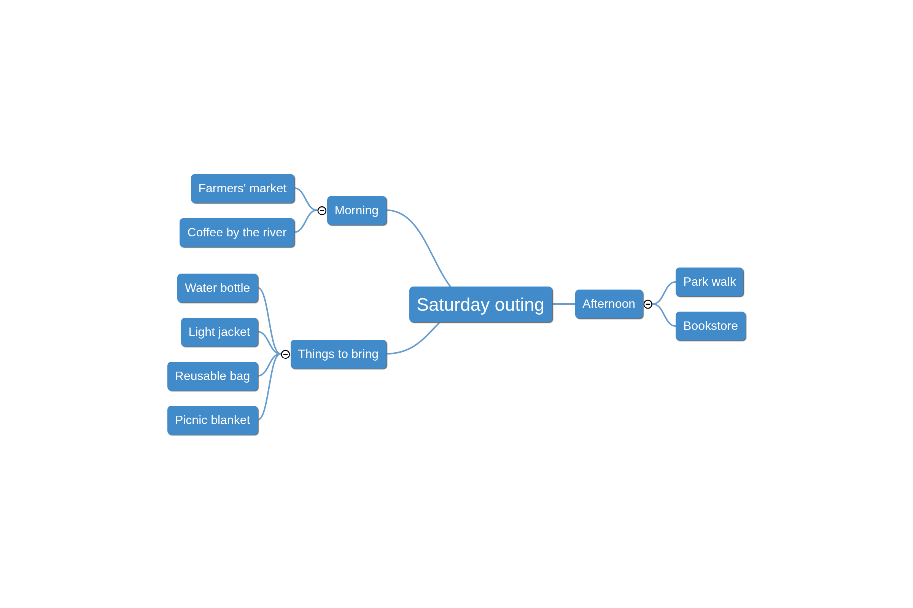
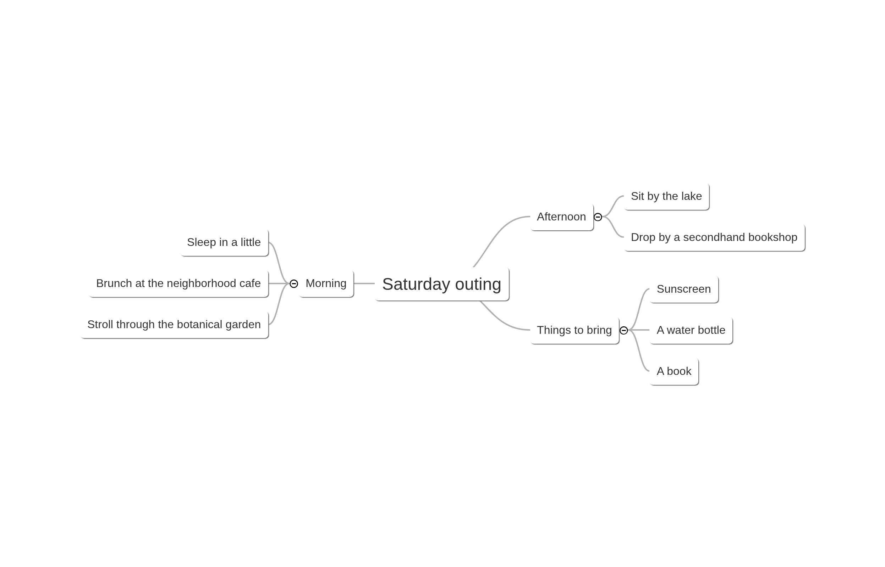

# Build your first mind map with the jsMind Skill

> Applies to jsMind 2.x (currently a preview; details may change between releases).

In this tutorial you will ask an AI agent to install the jsMind Skill, sort out a few weekend options as a mind map, and export it as a PNG. You can follow along with the same kind of prompts. The map itself is up to the agent: yours does not have to match the one on this page.

<script setup>
import exampleMap from '../../assets/161-example.json?url';
</script>



## What you will make

A mind map that sorts out a few ways to spend the weekend, and under each option, what you need to prepare. The picture above comes from one real run, after a colour change. If you use the same prompt, the agent may build a different tree — that is expected. You are learning the flow (install, ask, let the CLI build the map, then recolour and export), not copying a fixed outline.

You can download this run's finished map here: <a :href="exampleMap" download="weekend-outing.json">weekend-outing.json</a>.

## What you need

- Node.js 22.12.0 or later
- An AI agent that can install skills
- jsMind 2.x
- A Chromium-based browser on the same machine (the CLI uses it to render the PNG)

Install the 2.x package explicitly:

```bash
npm i jsmind@2
```

Then run the CLI as `npx jsmind@2`. The skill itself writes commands as `jsmind ...`. If `jsmind` is already on your PATH, that form works too. Prefer `npx jsmind@2` unless you know 2.x is the one being resolved: an unscoped `npx jsmind` may not invoke 2.x.

## Install the skill

Give this prompt to your agent:

```
Install the jsMind skill from https://hizzgdev.github.io/jsmind-v2/skills/jsmind/INSTALL.md — read that file and follow it.
```

The install notes will place the skill where your agent loads skills, and will check that the 2.x CLI is available. You do not need to pick a path yourself.

For other install options, see the [Skill](https://hizzgdev.github.io/jsmind-v2/docs/en/guide/skill) page in the documentation.

## Ask the agent to build the map

Once the skill is installed, paste this prompt:

```
I'm thinking of going out this weekend. There's a new morning market nearby I want to check out, and if it's not interesting I could stop by the bookstore next to it. Or I could take a walk in the park, and if I get tired I can have coffee by the river. If I can get friends to come along, even better — then we could go hiking. I haven't decided how to plan it yet. Could you use jsMind to make a mind map that helps me sort out these options, and under each option list what I need to prepare?
```

You can also ask the agent to export a PNG in the same message, or as a follow-up. The walkthrough below includes that export.

The agent should use the jsMind CLI to create and edit the file. It should not write the map by hand. It will invent the branches and labels itself, so the tree on your machine may not look like the one below.

## What the agent does

The pictures and download on this page come from one real run of a prompt like the one above. The English map uses the same tree, with translated labels. It is an illustration, not the required answer. After every write, take ids from the command that just ran, or run `context` again. Do not copy the ids below into your own commands.

The skill writes `jsmind`. The session below uses `npx jsmind@2`, which is the safe form when the CLI is not already on your PATH. In this run the map was saved as `weekend-outing.json` (and later `weekend-outing.png`); yours may differ.

First it creates the map. `create` prints the root id — here it is `root`, which is the default, but you should still read it from the reply. The root id is data, and a file written elsewhere can name it anything.

```
$ npx jsmind@2 create weekend-outing.json --title "Going out this weekend"
created weekend-outing.json (root node id root)
```

Then it adds branches with `mind add-child`, one node per command — there is no batch form of `add-child`. `--side left` or `--side right` is only allowed when the parent is the root. A new root child defaults to the right if you omit `--side`. Deeper nodes inherit their branch's side; passing `--side` there is an error.

The reply of each `add-child` carries the new id. Use it as `--parent-id` for the next children, instead of searching again.

This run grouped the weekend into three options: visiting the new morning market (left), walking in the park (right), and hiking with friends (also left). Under each option it listed what to prepare — including a few labels that repeat a parent, which is left as the agent wrote it.

Then the agent validates the file and looks at the tree. `context` shows two levels by default, so this session passes `--depth 3` to include the preparation items, and `--full-text` so longer labels are not truncated:

```
$ npx jsmind@2 validate weekend-outing.json
weekend-outing.json: valid

$ npx jsmind@2 context weekend-outing.json --depth 3 --full-text
root          Going out this weekend {side=center}
jm-mwxkp09e     Visit the new morning market {side=left}
jm-mwxkp0q3       Browse the market
jm-mwxkp0vi         Check opening hours and location
jm-mwxkp10v         Bring cash and a reusable bag
jm-mwxkp16a       If it's dull, go to the bookstore next door
jm-mwxkp1br         Check the bookstore's hours
jm-mwxkp1hd         Bring a library card and a book you want
jm-mwxkp0ey     Walk in the park {side=right}
jm-mwxkp1mm       Walk in the park
jm-mwxkp1rw         Check the weather and wear comfortable shoes
jm-mwxkp1y5         Pick a walking route
jm-mwxkp23l       If tired, have coffee by the river
jm-mwxkp28z         Find a cafe by the river
jm-mwxkp2e5         Bring a book or headphones
jm-mwxkp0kt     Hike with friends {side=left}
jm-mwxkp2jq       Invite friends
jm-mwxkp2p2         Agree who is coming and when
jm-mwxkp2ui         Check that everyone is up for it
jm-mwxkp304       Go hiking
jm-mwxkp35j         Hiking shoes, water, and sunscreen
jm-mwxkp3ay         Check trail difficulty and the weather
```

`export` writes a PNG next to the map. The default viewport is 1200×800 at scale 2, so a typical export is 2400×1600 pixels; if the map is wider, the image grows with it. This run came out at 4374×1600, because some labels were a little long. If Chromium is not in a standard location, set `CHROME_PATH`.

```
$ npx jsmind@2 export weekend-outing.json weekend-outing.png
weekend-outing.png: 4374x1600 (379.5 KB)
```

The picture at this point is the first draft from this run, still in the default white tone:



## Keep chatting if you want to change something

If something is missing, or you want to add or adjust an item, you can keep chatting and ask the agent to update the map, then export again. `export` overwrites the PNG in place. If you want to keep the earlier picture, give the next export a different filename, or rename the first file first.

This page leaves the tree as the agent first built it, and only changes the colour in the next step.

## Give the whole map a colour

The default tone is white, which is what the first export used. One command can change the colour of every node that does not have its own tone. That command is `mind set-style`; you do not colour each node with `node set-style`.

The stock tones include `default` (white), `primary` (blue), `success` (green), `warning` (orange), `danger` (red), `info` (light blue), and `accent` (purple). This walkthrough uses `primary`. If a node already had its own tone, that tone would still win.

Ask the agent in plain language:

```
The default white looks a bit plain. Could you make the whole map blue (the primary tone) and export it again?
```

```
$ npx jsmind@2 mind set-style weekend-outing.json --default-tone primary
set style of weekend-outing.json: default-tone=primary

$ npx jsmind@2 export weekend-outing.json weekend-outing.png
weekend-outing.png: 4374x1600 (398.0 KB)
```


## Where the files are

Both files typically land in the working directory of the conversation, unless the agent tells you otherwise. In this run they were called `weekend-outing.json` and `weekend-outing.png`; your agent may pick different names.

- The `.json` file is the map itself. It is a JSON document.
- The `.png` file is the picture. Open it in any image viewer or browser.

The agent should also print the absolute paths of both files. You can download this run's finished example from this page: <a :href="exampleMap" download="weekend-outing.json">weekend-outing.json</a>.

## Next steps

- [Getting Started](https://hizzgdev.github.io/jsmind-v2/docs/en/guide/getting-started) — install jsMind 2.x and create a first map yourself
- [Skill](https://hizzgdev.github.io/jsmind-v2/docs/en/guide/skill) — more on installing and using the skill
- [CLI](https://hizzgdev.github.io/jsmind-v2/docs/en/guide/cli) — every command and flag
- [Playground](https://hizzgdev.github.io/jsmind-v2/playground.html) — open a map in the browser and edit it
