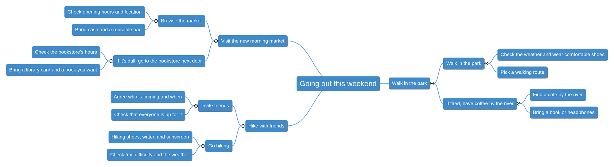
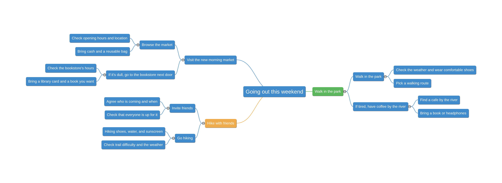

# Color specific nodes to mark what matters

> Applies to jsMind 2.x (currently a preview; details may change between releases).

<script setup>
import startMap from '../../assets/162-start.json?url';
import exampleMap from '../../assets/162-example.json?url';
</script>

In [Build your first mind map with the jsMind Skill](./161-first-mind-map-with-skill), the whole map was given one tone. This tutorial starts from that finished map and colours only the options that matter, so you can see them at a glance. If you have not followed 161, download the starting map below and continue from here — you do not need to redraw it.

You can download the starting map here: <a :href="startMap" download="weekend-outing.json">weekend-outing.json</a>. If you already have the file from 161, you can keep using that one. The commands below use `weekend-outing.json` as the filename.



## Ask the agent to mark what matters

Copy this prompt into a conversation where the jsMind Skill is already available, and attach or point to your starting map:

```
I already have a weekend outing mind map. Now I want to see it more clearly: walking in the park is something I prefer, hiking with friends depends on whether people are free — that’s still uncertain — and the morning market and bookstore can just stay as notes for now. Please mark them with colors on the map so I can tell at a glance which ones I want more, and which ones are still uncertain.
```

The same prompt may come back with different colours; that is expected. This walkthrough uses green for something you prefer and orange for something still uncertain, so the pictures have a concrete meaning. If your agent picks other tones, you have not done it wrong.

## Find the first-level ids, then set a tone

161 used `mind set-style --default-tone` to colour the whole map. That document default stays `primary` (blue) here. To colour one node, use `node set-style --tone`.

Do not pick a node by its text alone. On this map, "Walk in the park" appears twice: once as a first-level option, and once as a child under it. Run `context` first, and colour the first-level option.

`context --highlight` is not a visual highlight. It finds node ids by label (a case-insensitive match of the whole label) and lists them at the top of the output.

If you are continuing from the starting file downloaded on this page, the ids in the walkthrough will match. If you are continuing from a map your agent generated in 161, run `context` again on that file and use the ids it prints. Do not paste the ids from this page into a different map.

```bash
npx jsmind@2 context weekend-outing.json --highlight "Walk in the park" --highlight "Hike with friends" --full-text
```

```
highlighted:
  "Walk in the park"  -> "root"/"jm-mwxkp0ey" (+1 more)
  "Hike with friends" -> "root"/"jm-mwxkp0kt"

fullmap:
style: theme=default defaultTone=primary overrides=defaultTone
root          Going out this weekend {side=center}
jm-mwxkp09e     Visit the new morning market {side=left}
jm-mwxkp0q3       Browse the market
jm-mwxkp16a       If it's dull, go to the bookstore next door
jm-mwxkp0ey     Walk in the park {side=right}
jm-mwxkp1mm       Walk in the park
jm-mwxkp23l       If tired, have coffee by the river
jm-mwxkp0kt     Hike with friends {side=left}
jm-mwxkp2jq       Invite friends
jm-mwxkp304       Go hiking
```

The `(+1 more)` next to "Walk in the park" is that same-named child. The first id, `jm-mwxkp0ey`, is the first-level option — that is the one to colour.

```bash
npx jsmind@2 node set-style weekend-outing.json --node-id jm-mwxkp0ey --tone success
npx jsmind@2 node set-style weekend-outing.json --node-id jm-mwxkp0kt --tone warning
```

```
set style of jm-mwxkp0ey: {"tone":"success"}
set style of jm-mwxkp0kt: {"tone":"warning"}
```

"Visit the new morning market" is left unchanged, so it stays the document-level `primary` (blue). In the docs, `default` is white; `primary` is blue.

A tone does not flow down the branch. Only the node you set is overridden; its children still fall back to the document's `primary`. You can see that in the picture: the children under "Walk in the park" and "Hike with friends" stay blue.

You can also pass `--background` and `--color` to `node set-style` for a custom colour. This walkthrough stays with tones.

## Export an image

```bash
npx jsmind@2 export image weekend-outing.json weekend-outing.png
```

```
weekend-outing.png: 4374x1600 (398.1 KB)
```



## Where the files are

The commands above write to `weekend-outing.json` and `weekend-outing.png` in the working directory, unless the agent tells you otherwise. Your agent may pick different names.

- The `.json` file is the map itself. It is a JSON document.
- The `.png` file is the picture. Open it in any image viewer or browser.

You can also download the files from this page:

- Starting map (all `primary`): <a :href="startMap" download="weekend-outing.json">weekend-outing.json</a>
- After colouring the two options: <a :href="exampleMap" download="weekend-outing-colored.json">weekend-outing-colored.json</a>

## Next steps

- [Build your first mind map with the jsMind Skill](./161-first-mind-map-with-skill) — if you want to build the starting map from scratch
- [Skill](https://hizzgdev.github.io/jsmind-v2/docs/en/guide/skill) — more on installing and using the skill
- [CLI](https://hizzgdev.github.io/jsmind-v2/docs/en/guide/cli) — every command and flag
- [Playground](https://hizzgdev.github.io/jsmind-v2/playground.html) — open a map in the browser and edit it
