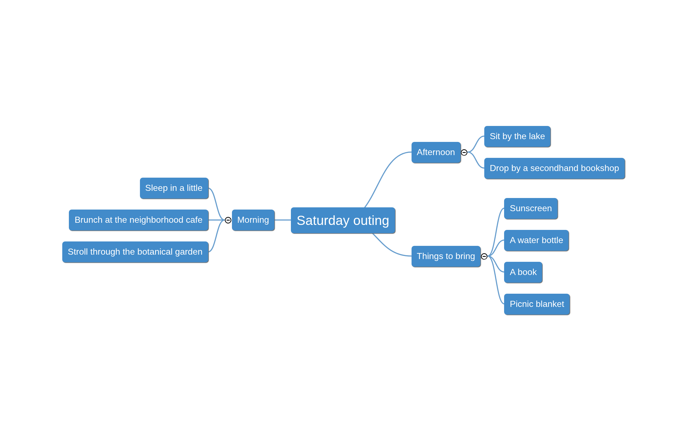
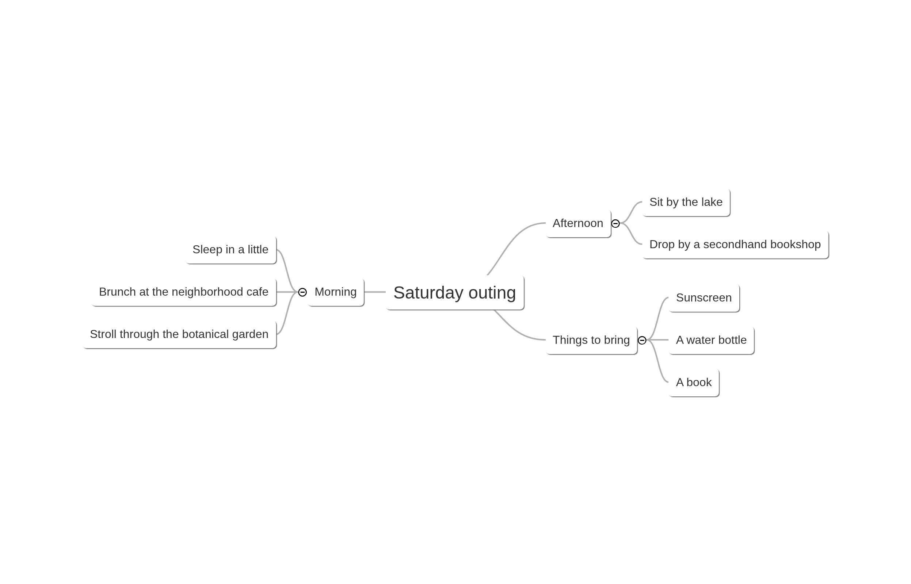

# 用 jsMind Skill 做你的第一张思维导图

> 适用版本：2.x（当前为 preview，内容可能随版本变化）

这篇文章会带你请 AI agent 安装 jsMind Skill，用它计划一次周六出游，做成思维导图，并导出成 PNG。下面的 prompt 可以直接复制使用。导图的具体内容由 agent 来想：你得到的树不必和本页这张一样。

<script setup>
import exampleMap from '../../assets/161-example.jm?url';
</script>



## 你将做成什么

一张周末出游计划的思维导图：上午和下午怎么安排，要带些什么。上面这张图是一次真实运行的结果，中间还改过一处、并换过颜色。你用同一段 prompt，agent 完全可能排出不一样的一天——这很正常。你要学的是流程（安装、提出需求、让 CLI 生成导图，再修改、换色、导出），而不是抄一份固定大纲。

这次运行做成的导图可以在这里下载：<a :href="exampleMap" download="saturday-outing.jm">161-example.jm</a>。

## 你需要准备什么

- Node.js 22.12.0 或更高版本
- 一个能安装 skill 的 AI agent
- jsMind 2.x
- 同一台机器上有基于 Chromium 的浏览器（CLI 导出 PNG 时要用它来渲染）

请明确安装 2.x 版本：

```bash
npm i jsmind@2
```

然后用 `npx jsmind@2` 来运行 CLI。Skill 里写的命令是 `jsmind ...`。如果 `jsmind` 已经在 PATH 里，那种写法也可以。除非你确定当前解析到的就是 2.x，否则请优先用 `npx jsmind@2`：不带版本的 `npx jsmind` 不一定会跑到 2.x。

## 安装 skill

把下面这段 prompt 交给你的 agent：

```
请从 https://hizzgdev.github.io/jsmind-v2/skills/jsmind/INSTALL.md 安装 jsMind skill：读这份文件并照做。
```

安装说明会把 skill 放到你的 agent 会加载的位置，并确认 2.x CLI 可用。你不必自己指定路径。

其他安装方式见文档里的 [Skill](https://hizzgdev.github.io/jsmind-v2/docs/zh/guide/skill) 页面。

## 请 agent 生成这张导图

skill 装好之后，把下面这段 prompt 贴给它：

```
请使用 jsMind skill，围绕周六出游做一张思维导图，并导出为 PNG。我们想计划一次周末出游：上午和下午怎么安排，要带些什么。文件写到当前工作目录。如果 skill 已经加载过，直接用。如果同名文件已存在，换个名字，不要覆盖。做完之后，两个文件都应该在，PNG 要看得清楚，并告诉我它们的绝对路径。
```

agent 应当通过 jsMind CLI 来创建和修改文件，不要亲手去写这份导图。分支和节点文字由它来想，所以你这边的树未必会和下面对得上。

## agent 实际会做什么

下面是生成本页这张中文导图时的一次真实会话，用来说明流程，并不是标准答案。每次写入之后，请用刚刚那条命令返回的 id，或者再运行一次 `context`，不要把下面这些 id 抄进自己的命令里。

Skill 里写的是 `jsmind`。下面的会话用 `npx jsmind@2`，这是 CLI 还不在 PATH 里时更稳妥的写法。这次运行里，agent 选用的文件名是 `saturday-outing.jm` 和 `saturday-outing.png`；你那边可能会不一样。

它先创建导图。`create` 会打印根节点 id——这里是 `root`，也就是默认值，但仍然要从回复里读，不要直接假定。根节点的 id 是数据，在别处生成或编辑过的文件完全可能叫别的名字。

```
$ npx jsmind@2 create saturday-outing.jm --title "周六出游"
created saturday-outing.jm (root node id root)
```

接着用 `mind add-child` 添加一级分支。`--side left` 或 `--side right` 只在父节点是根节点时才允许使用。如果省略 `--side`，新的根子节点默认放在右侧。更深层的节点会继承所属一级分支的侧向，在那里再传 `--side` 会报错。

```
$ npx jsmind@2 mind add-child saturday-outing.jm --parent-id root --text "上午" --side left
added node (id jm-mwxh4j3j) under root (side=left)
```

这条回复里带有新节点的 id。把它当作后续子节点的 `--parent-id` 即可，不必再查一遍：

```
$ npx jsmind@2 mind add-child saturday-outing.jm --parent-id jm-mwxh4j3j --text "睡到自然醒"
added node (id jm-mwxh4j4h) under jm-mwxh4j3j

$ npx jsmind@2 mind add-child saturday-outing.jm --parent-id jm-mwxh4j3j --text "在附近吃早午餐"
added node (id jm-mwxh4j5e) under jm-mwxh4j3j

$ npx jsmind@2 mind add-child saturday-outing.jm --parent-id jm-mwxh4j3j --text "逛植物园"
added node (id jm-mwxh4j6b) under jm-mwxh4j3j
```

另外两个分支也是同样的做法——这次 agent 安排了下午的行程，以及一份要带的东西：

```
$ npx jsmind@2 mind add-child saturday-outing.jm --parent-id root --text "下午" --side right
added node (id jm-mwxh4j7b) under root (side=right)

$ npx jsmind@2 mind add-child saturday-outing.jm --parent-id jm-mwxh4j7b --text "湖边坐坐"
added node (id jm-mwxh4j88) under jm-mwxh4j7b

$ npx jsmind@2 mind add-child saturday-outing.jm --parent-id jm-mwxh4j7b --text "顺路逛旧书店"
added node (id jm-mwxh4j96) under jm-mwxh4j7b

$ npx jsmind@2 mind add-child saturday-outing.jm --parent-id root --text "要带的东西" --side right
added node (id jm-mwxh4ja4) under root (side=right)

$ npx jsmind@2 mind add-child saturday-outing.jm --parent-id jm-mwxh4ja4 --text "防晒霜"
added node (id jm-mwxh4jb3) under jm-mwxh4ja4

$ npx jsmind@2 mind add-child saturday-outing.jm --parent-id jm-mwxh4ja4 --text "水杯"
added node (id jm-mwxh4jbz) under jm-mwxh4ja4

$ npx jsmind@2 mind add-child saturday-outing.jm --parent-id jm-mwxh4ja4 --text "一本书"
added node (id jm-mwxh4jcw) under jm-mwxh4ja4
```

每次只能加一个节点：`add-child` 没有批量写法。

然后 agent 会校验文件，并查看整棵树。`context` 默认只显示两层，所以这次加了 `--depth 3`，才能看到孙节点：

```
$ npx jsmind@2 validate saturday-outing.jm
saturday-outing.jm: valid

$ npx jsmind@2 context saturday-outing.jm --depth 3
root          周六出游 {side=center}
jm-mwxh4j3j     上午 {side=left}
jm-mwxh4j4h       睡到自然醒
jm-mwxh4j5e       在附近吃早午餐
jm-mwxh4j6b       逛植物园
jm-mwxh4j7b     下午 {side=right}
jm-mwxh4j88       湖边坐坐
jm-mwxh4j96       顺路逛旧书店
jm-mwxh4ja4     要带的东西 {side=right}
jm-mwxh4jb3       防晒霜
jm-mwxh4jbz       水杯
jm-mwxh4jcw       一本书
```

`export` 会在导图旁边写出一张 PNG。默认视口是 1200×800、缩放为 2，所以常见的导出尺寸是 2400×1600 像素；如果导图更宽，图片会跟着变大。如果 Chromium 不在常见位置，需要设置 `CHROME_PATH`。

```
$ npx jsmind@2 export saturday-outing.jm saturday-outing.png
saturday-outing.png: 2400x1600 (143.9 KB)
```

这时的图片是这次运行的第一稿，还是默认的白色，也还没有「野餐垫」：



## 再改一处，然后重新导出

第一张图已经像一份计划了，不过这次下午要去湖边坐坐，却忘了野餐垫。用这样的跟进就够了，不必替 agent 把命令写死：

```
我们忘了野餐垫，湖边坐着会用上。请在要带的东西里补上，再导出一次 PNG。
```

`export` 会原地覆盖原来的 PNG。如果想保留第一张图，第二次导出时换一个文件名，或者先把旧文件改个名字。

agent 应当重新查找父节点，不要沿用更早记住的 id。`context --highlight` 可以把标签对应到当前的 id：

```
$ npx jsmind@2 context saturday-outing.jm --highlight "要带的东西"
highlighted:
  "要带的东西" -> "root"/"jm-mwxh4ja4"
```

```
$ npx jsmind@2 mind add-child saturday-outing.jm --parent-id jm-mwxh4ja4 --text "野餐垫"
added node (id jm-mwxh4jzl) under jm-mwxh4ja4

$ npx jsmind@2 validate saturday-outing.jm
saturday-outing.jm: valid

$ npx jsmind@2 export saturday-outing.jm saturday-outing.png
saturday-outing.png: 2400x1600 (154.5 KB)
```

## 给整张导图换个颜色

默认色调是白色，第一次导出用的就是它。一条命令就能改掉所有还没有自己色调的节点。这条命令是 `mind set-style`，不必对每个节点再跑一遍 `node set-style`。

现成的色调有 `default`（白）、`primary`（蓝）、`success`（绿）、`warning`（橙）、`danger`（红）、`info`（浅蓝）和 `accent`（紫）。这次演示用 `primary`。如果某个节点已经有自己的色调，仍然以节点自己的为准。

用平常的话说给 agent 即可：

```
默认的白色有点素。请把整张导图改成蓝色（用 primary 这个色调），再导出一次。
```

```
$ npx jsmind@2 mind set-style saturday-outing.jm --default-tone primary
set style of saturday-outing.jm: default-tone=primary

$ npx jsmind@2 export saturday-outing.jm saturday-outing.png
saturday-outing.png: 2400x1600 (161.5 KB)
```


## 文件写在哪里

这两个文件会出现在你指定的工作目录里——也就是你发出 prompt 时所在的目录，除非 agent 另外告诉了你别的位置。这次运行里，文件名是 `saturday-outing.jm` 和 `saturday-outing.png`；你的 agent 可能会取不一样的名字。

- `.jm` 文件是导图本身。它是一份 JSON 文档，用 `.jm` 做扩展名完全可以，CLI 也接受这种写法。
- `.png` 文件是图片。用任何看图软件或浏览器打开即可。

agent 还应当给出两个文件的绝对路径。本页也可以下载这次做成的示例：<a :href="exampleMap" download="saturday-outing.jm">161-example.jm</a>。

## 接下来可以看

- [快速上手](https://hizzgdev.github.io/jsmind-v2/docs/zh/guide/getting-started) — 安装 jsMind 2.x，自己做一张导图
- [Skill](https://hizzgdev.github.io/jsmind-v2/docs/zh/guide/skill) — skill 的安装与用法
- [CLI](https://hizzgdev.github.io/jsmind-v2/docs/zh/guide/cli) — 全部命令和参数
- [Playground](https://hizzgdev.github.io/jsmind-v2/playground.html) — 在浏览器里打开一张导图并直接编辑
