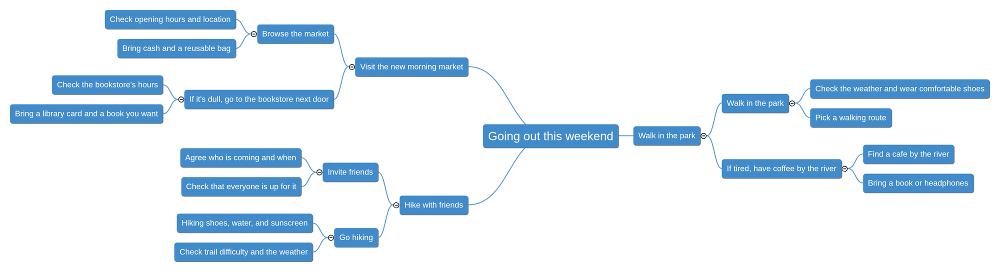
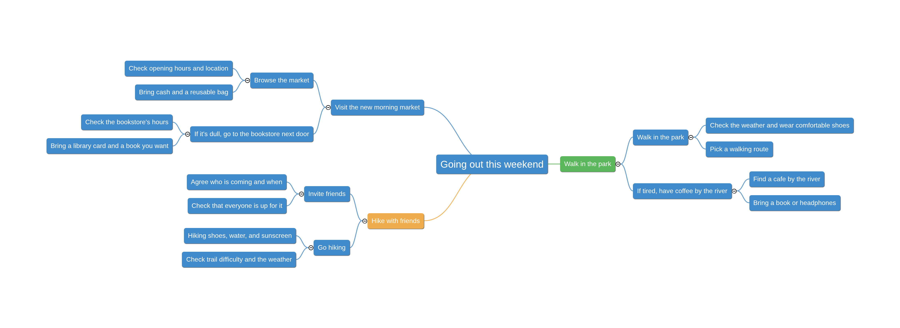

# 给指定节点上色，把重点标出来

> 适用版本：2.x（当前为 preview，内容可能随版本变化）

<script setup>
import startMap from '../../assets/162-start.json?url';
import exampleMap from '../../assets/162-example.json?url';
</script>

在[用 jsMind Skill 做你的第一张思维导图](./161-first-mind-map-with-skill)里，整张图用了同一种色调。这篇从那张做好的图接着往下做，只给真正在意的选项上色，让你一眼能看出重点。如果还没有做过 161，先下载下面的起始图，不必重画。

起始图可以在这里下载：<a :href="startMap" download="weekend-outing.json">weekend-outing.json</a>。如果你手里已经有 161 里做成的那份文件，继续用那一份即可。



## 让 agent 把重点标出来

把这段 prompt 复制到已经启用 jsMind Skill 的对话里，并附上或指向你的起始图：

```
我已经有一张周末出游的思维导图了。现在我想得更清楚一点：公园散步是我比较想去的，约朋友爬山要看大家有没有空，还不一定，早市和书店先记着就行。你帮我在图上用颜色标一下，让我一眼能看出哪些是更想做的，哪些还不一定。
```

同样的 prompt 可能标出不一样的颜色，这是正常的。这篇演示里用绿色表示比较想去、橙色表示还不一定，只是为了让配图有一个具体含义。如果你的 agent 选了别的色调，并不代表你做错了。

也可以在同一条消息里，或者再跟一句，请它导出一张 PNG。

## 看看演示结果



上面这张图和开头的动图来自一次真实运行。一级选项「公园散步」是绿色（success），表示比较想去；「约朋友爬山」是橙色（warning），表示还不一定。「逛新开的早市」没有单独上色，所以仍是整图的 `primary`（蓝色）。文档里 `default` 是白色，`primary` 才是蓝色。

色调只作用在被改到的那个节点上，不会顺着分支传到子节点。所以「公园散步」和「约朋友爬山」下面的准备事项仍是蓝色。

## agent 实际会做什么

你不必自己去跑命令。agent 应当通过 jsMind CLI 来改图，不要亲手去改这份 JSON。本页的图片和下载来自上面这类 prompt 的一次真实运行，用来说明流程，并不是标准答案。

[第一篇](./161-first-mind-map-with-skill)里给整张图换色，用的是 `mind set-style --default-tone`。这里整图的默认色调仍然是 `primary`；要给单个节点上色，agent 用的是 `node set-style --tone`。

这张图里，「公园散步」出现了两次：一次是一级选项，一次是它下面的同名子节点。agent 需要先弄清该改哪一个，再给一级选项上色。如果你用的是本页下载的起始图，节点 id 可以对上这次演示；如果你用的是自己在 161 里生成的图，id 会不一样，agent 应该在那份文件上重新查看结构，不要套用本页的 id。

下面是这次演示里 agent 用到的命令，只用来说明它做了什么，不是要你照着输入：

```
$ npx jsmind@2 node set-style weekend-outing.json --node-id jm-mwxkp0ey --tone success
set style of jm-mwxkp0ey: {"tone":"success"}

$ npx jsmind@2 node set-style weekend-outing.json --node-id jm-mwxkp0kt --tone warning
set style of jm-mwxkp0kt: {"tone":"warning"}
```

「逛新开的早市」没有改，所以仍是文档级的 `primary`。

agent 可能会把结果写到工作目录里的 `weekend-outing.json`，并再导出一张 PNG；它也可能使用别的文件名，并告诉你文件的位置。本页也可以下载这些文件：

- 起始图（全部是 `primary`）：<a :href="startMap" download="weekend-outing.json">weekend-outing.json</a>
- 给两个选项上色之后：<a :href="exampleMap" download="weekend-outing-colored.json">weekend-outing-colored.json</a>

## 接下来可以看

- [用 jsMind Skill 做你的第一张思维导图](./161-first-mind-map-with-skill) — 如果想从零做起始图
- [Skill](https://hizzgdev.github.io/jsmind-v2/docs/zh/guide/skill) — skill 的安装与用法
- [CLI](https://hizzgdev.github.io/jsmind-v2/docs/zh/guide/cli) — 全部命令和参数
- [Playground](https://hizzgdev.github.io/jsmind-v2/playground.html) — 在浏览器里打开一张导图并直接编辑
